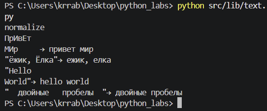
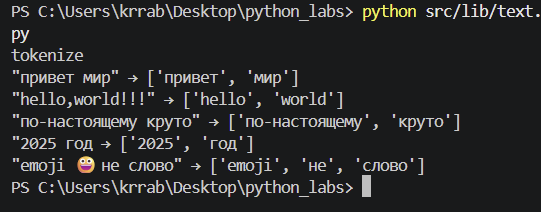
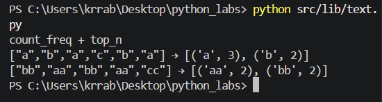
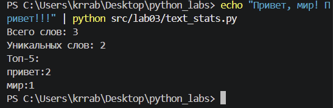

## Лабораторная работа №3

### Задание А - `src/lib/text.py`
Реализуйте функции:

`normalize(text: str, *, casefold: bool = True, yo2e: bool = True) -> str`
Если `casefold=True` — привести к casefold (лучше, чем `lower` для Юникода). Если `casefold=False` - используем lower().
    
Если `yo2e=True` — заменить все `ё/Ё` на `е/Е`.

 Убрать невидимые управляющие символы (например, `\t`, `\r`) → заменить на пробелы, схлопнуть повторяющиеся пробелы в один.

`tokenize(text: str) -> list[str]`

Разбить на «слова» по небуквенно-цифровым разделителям.
    
В качестве слова считаем последовательности символов `\w` (буквы/цифры/подчёркивание) плюс дефис внутри слова (например, `по-настоящему`).

Числа (например, `2025`) считаем словами.

`count_freq(tokens: list[str]) -> dict[str, int]`

Подсчитать частоты, вернуть словарь слово → количество. 
    
`top_n(freq: dict[str, int], n: int = 5) -> list[tuple[str, int]]`

Вернуть топ-N по убыванию частоты; при равенстве — по алфавиту слова.

  

```python 
import re
from collections import Counter
 
 
def normalize(text: str, *, casefold: bool = True, yo2e: bool = True) -> str:
    text = text.casefold() if casefold else text.lower()
    if yo2e:
        text = text.replace("ё", "е")
    # управляющие символы и пробелы -> один пробел
    return re.sub(r"[\s\x00-\x1f\x7f-\x9f]+", " ", text).strip()

# print('normalize')
# print(f'ПрИвЕт\nМИр\t→ {normalize("ПрИвЕт\nМИр\t")}')
# print(f'"ёжик, Ёлка"→ {normalize("ёжик, Ёлка")}')
# print(f'"Hello\r\nWorld"→ {normalize("Hello\r\nWorld")}')
# print(f'"  двойные   пробелы  "→ {normalize("  двойные   пробелы  ")}')

def tokenize(text: str) -> list[str]:
    return re.findall(r"\w+(?:-\w+)*", text)

# print('tokenize')
# print(f'"привет мир" → {tokenize("привет мир")}')
# print(f'"hello,world!!!" → {tokenize("hello,world!!!")}')
# print(f'"по-настоящему круто" → {tokenize("по-настоящему круто")}')
# print(f'"2025 год → {tokenize("2025 год")}')
# print(f'"emoji 😀 не слово" → {tokenize("emoji 😀 не слово")}')

def count_freq(tokens: list[str]) -> dict[str, int]:
    return dict(Counter(tokens))
def top_n(freq: dict[str, int], n: int = 5) -> list[tuple[str, int]]:
    return sorted(freq.items(), key=lambda kv: (-kv[1], kv[0]))[:max(n, 0)]


print('count_freq + top_n')
print(f'["a","b","a","c","b","a"] → {top_n(count_freq(["a","b","a","c","b","a"]), n=2)}')
print(f'["bb","aa","bb","aa","cc"] → {top_n(count_freq(["bb","aa","bb","aa","cc"]), n=2)}')
```







### Задание B — `src/text_stats.py (скрипт со stdin)`

Скрипт читает одну строку текста из stdin (или весь ввод до EOF — на ваш выбор, опишите в README), вызывает функции из `lib/text.py` и печатает:

`Всего слов: <N>`
`Уникальных слов: <K>`
`Топ-5:` — по строке на запись в формате `слово:кол-во` (по убыванию, как в `top_n`).

```python
import sys
from pathlib import Path

sys.path.insert(0, str(Path(__file__).resolve().parent.parent))
from lib.text import normalize, tokenize, count_freq, top_n

sys.stdin.reconfigure(encoding="utf-8")

text = sys.stdin.read()
ntext=normalize(text)
words=tokenize(ntext)
freq= count_freq(words)
top=top_n(freq, n=5)

print(f'Всего слов: {len(words)}')
print(f'Уникальных слов: {len(freq)}')
print('Топ-5:')
for word, count in top:
    print(f'{word}:{count}')
```


