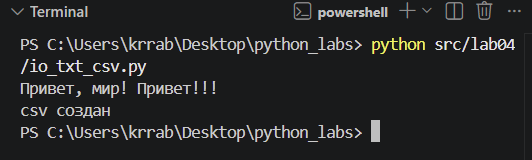
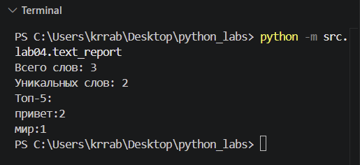
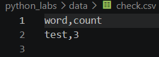

## Лабораторная работа №3

### Задание А - `src/lab04/io_txt_csv.p`
Реализуйте (с докстрингами и типами):

1. `read_text(path: str | Path, encoding: str = "utf-8") -> str`
    - Открыть файл на чтение в указанной кодировке и вернуть содержимое как **одну строку**.
    - Обрабатывать ошибки: если файл не найден — поднимать `FileNotFoundError` (пусть падает), если кодировка не подходит — поднимать `UnicodeDecodeError` (пусть падает).
    - НО: в докстринге опишите, как пользователь может выбрать другую кодировку (пример: `encoding="cp1251"`).

2. `write_csv(rows: list[tuple | list], path: str | Path, header: tuple[str, ...] | None = None) -> None`
    - Создать/перезаписать CSV с разделителем `,`.
    - Если передан `header`, записать его первой строкой.
    - Проверить, что каждая строка в `rows` имеет одинаковую длину (иначе `ValueError`).

★ (опционально, но полезно) `ensure_parent_dir(path: str | Path) -> None`
    - Создать родительские директории, если их нет (для удобства перед записью).

```python

import csv
from pathlib import Path


def read_text(path: str | Path, encoding: str = "utf-8") -> str:
    """Читает текстовый файл и возвращает его содержимое одной строкой.

    Args:
        path: путь к файлу (строка или ``pathlib.Path``).
        encoding: кодировка файла, по умолчанию ``"utf-8"``.

    Returns:
        Содержимое файла как одна строка (для пустого файла - ``""``).

    Raises:
        FileNotFoundError: если файл не найден.
        UnicodeDecodeError: если файл нельзя декодировать в указанной
            кодировке.

    Как выбрать другую кодировку:
        передать её в аргумент ``encoding``. Например, для файла,
        сохранённого в Windows-1251::

            read_text("data/input.txt", encoding="cp1251")

        Если при чтении в UTF-8 возникает ``UnicodeDecodeError``,
        нужно прописать ``encoding="cp1251"``.
    """
    p = Path(path)
    return p.read_text(encoding=encoding)


def ensure_parent_dir(path: str | Path) -> None:
    """Создаёт родительские директории для ``path``, если их ещё нет.

    Args:
        path: путь к файлу, для которого нужна папка.
    """
    Path(path).parent.mkdir(parents=True, exist_ok=True)


def write_csv(rows: list[tuple | list], path: str | Path, header: tuple[str, ...] | None = None) -> None:
    """Создает/перезаписывает CSV-файл с разделителем ','.
    header: заголовок. Если передан, пишется первой строкой.
    ValueError: если строки в rows имеют разную длину.
    """
    rows = list(rows)
    if rows:
        width = len(rows[0])
        for row in rows:
            if len(row) != width:
                raise ValueError("все строки rows должны иметь одинаковую длину")
    p = Path(path)
    with p.open("w", newline="", encoding="utf-8") as f:
        writer = csv.writer(f)
        if header is not None:
            writer.writerow(header)
        for row in rows:
            writer.writerow(row)
if __name__ == "__main__":
    txt = read_text("data/lab04/input.txt")
    print(txt)  # должен вернуть строку
    write_csv([("word","count"),("test",3)], "data/lab04/check.csv")
    print('csv создан')  # создаст CSV

```


### Задание B - скрипт `src/lab04/text_report.py`

Напишите скрипт, который:

1. Читает один входной файл `data/input.txt` (путь можно захардкодить или принять параметром командной строки — опишите в README).
2. Нормализует текст (`lib/text.py`), токенизирует и считает частоты слов.
3. Сохраняет `data/report.csv` c колонками: `**word,count**`, отсортированными: count ↓, слово ↑ (при равенстве).
4. В консоль печатает краткое резюме:
    - `Всего слов: <N>`
    - `Уникальных слов: <K>`
    - `Топ-5: (список из top_n из ЛР3)`

```python
from src.lib.text import normalize, tokenize, count_freq, top_n
from src.lab04.io_txt_csv import read_text, write_csv

INPUT_PATH = "data/lab04/input.txt"
OUTPUT_PATH = "data/lab04/report.csv"
ENCODING = "utf-8"


def sorted_word_counts(freq: dict[str, int]) -> list[tuple[str, int]]:
    """Возвращает пары (слово, частота): по убыванию частоты, при равенстве по слову."""
    return sorted(freq.items(), key=lambda kv: (-kv[1], kv[0]))


def main() -> None:
    try:
        raw_text = read_text(INPUT_PATH, encoding=ENCODING)
    except FileNotFoundError:
        print(f"Ошибка: файл не найден: {INPUT_PATH}")
        return
    """Читает файл, считает частоты, сохраняет CSV и печататет сводку."""
    normalized_text = normalize(raw_text)
    tokens = tokenize(normalized_text)
    total_words = len(tokens)

    freq = count_freq(tokens)
    unique_words = len(freq)

    all_rows = sorted_word_counts(freq)
    top5 = top_n(freq, n=5)
    write_csv(all_rows, OUTPUT_PATH, header=("word", "count"))

    print(f"Всего слов: {len(tokens)}")
    print(f"Уникальных слов: {len(freq)}")
    print("Топ-5:")
    for word, count in top_n(freq, 5):
        print(f"{word}:{count}")


if __name__ == "__main__":
    main()
```



#### Краевые случаи

- **Пустой входной файл**: `report.csv` содержит только заголовок word,count, без строк с данными. В консоли выводятся `Всего слов: 0`, `Уникальных слов: 0` и `Топ-5:` без списка слов.

- **Файл не найден**: скрипт выводит сообщение `Ошибка: файл не найден: <путь>` и завершает работу.

- **Кодировки**: по умолчанию файлы читаются и записываются в `UTF-8`. Чтобы использовать другую кодировку, нужно изменить константу `ENCODING` в начале `text_report.py`, например, на `"cp1251"`.

- **Смена выходного и/или выходного файла**: пути к входному и выходному файлам задаются константами `INPUT_PATH` и `OUTPUT_PATH` в начале `text_report.py`. Чтобы обработать другой файл, нужно изменить их значения в коде.

#### Запуск `text_report.py`
```python
python -m src.lab04.text_report 
```

#### Тест-кейс (А)

Входной файл (data/lab04/input.txt)

```python
Привет, мир! Привет!!!
```

В консоли терминала

```python
Всего слов: 3
Уникальных слов: 2
Топ-5: 
привет: 2
мир: 1
```

Содержимое отчета

```python
word,count
привет,2
мир,1
```
