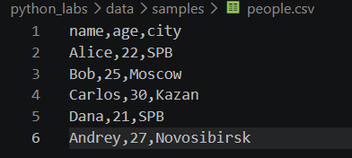
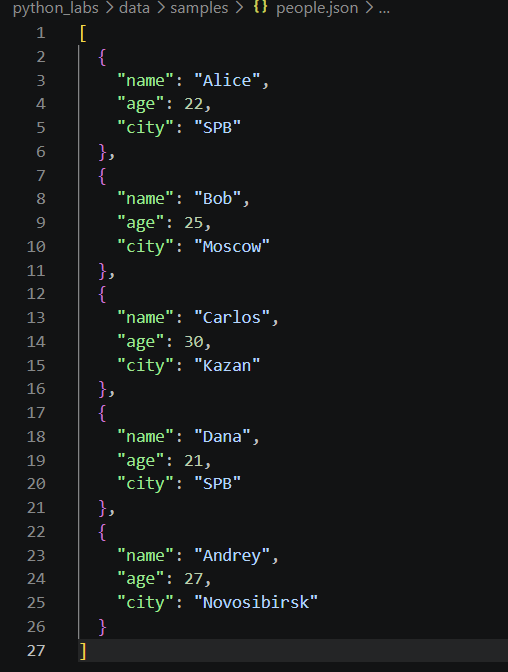
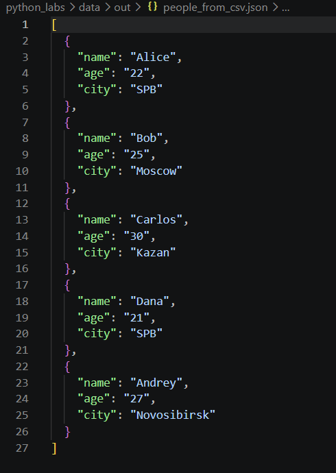
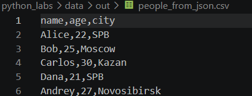
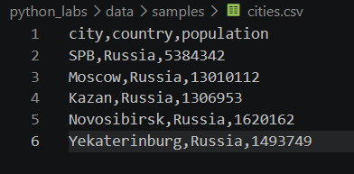
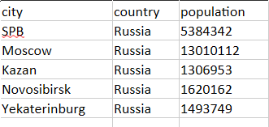

## Лабораторная №5

### Задание A — JSON ↔ CSV
Требования:

- Проверка ошибок:
    - неверный тип файла, пустой JSON или CSV → `ValueError`.
    - осутствующий файл → `FileNotFoundError`
- Не использовать внешние пакеты (только json, csv, pathlib).
- Все пути относительные.
- Кодировка — строго UTF-8.

```python
import csv
import json
from pathlib import Path


def _check_suffix(path: Path, suffix: str) -> None:
    """Проверяет расширение файла, иначе ValueError."""
    if path.suffix.lower() != suffix:
        raise ValueError(f"Неверный тип файла: ожидался {suffix}, получен {path.name!r}")


def json_to_csv(json_path: str, csv_path: str) -> None:
    """Преобразует JSON-файл (список словарей) в CSV.

    Порядок колонок: как в первом объекте; ключи, которых нет в первом
    объекте, добавляются в конец в порядке появления. Отсутствующие поля
    заполняются пустыми строками. Кодировка - UTF-8.

    Args:
        json_path: путь к входному ``.json`` файлу.
        csv_path: путь к выходному ``.csv`` файлу.

    Raises:
        FileNotFoundError: если JSON-файл не найден.
        ValueError: если расширение не ``.json``/``.csv``, JSON пустой
            (``[]`` или пустой файл), некорректен или не является
            списком словарей.
    """
    src, dst = Path(json_path), Path(csv_path)
    _check_suffix(src, ".json")
    _check_suffix(dst, ".csv")

    with open(src, encoding="utf-8") as f:
        text = f.read()
    if not text.strip():
        raise ValueError("Пустой JSON или неподдерживаемая структура")
    data = json.loads(text)  # JSONDecodeError - подкласс ValueError

    if not isinstance(data, list) or not data:
        raise ValueError("Пустой JSON или неподдерживаемая структура")
    if not all(isinstance(item, dict) for item in data):
        raise ValueError("Все элементы JSON-списка должны быть словарями")

    fieldnames: list[str] = []
    for item in data:
        for key in item:
            if key not in fieldnames:
                fieldnames.append(key)

    dst.parent.mkdir(parents=True, exist_ok=True)
    with open(dst, "w", newline="", encoding="utf-8") as f:
        writer = csv.DictWriter(f, fieldnames=fieldnames, restval="")
        writer.writeheader()
        writer.writerows(data)


def csv_to_json(csv_path: str, json_path: str) -> None:
    """Преобразует CSV-файл в JSON (список словарей).

    Заголовок обязателен (первая строка), все значения остаются строками.
    Запись: ``json.dump(..., ensure_ascii=False, indent=2)``, UTF-8.

    Args:
        csv_path: путь к входному ``.csv`` файлу.
        json_path: путь к выходному ``.json`` файлу.

    Raises:
        FileNotFoundError: если CSV-файл не найден.
        ValueError: если расширение не ``.csv``/``.json``, CSV пустой
            (нет заголовка или нет строк данных) или в строке больше
            значений, чем в заголовке.
    """
    src, dst = Path(csv_path), Path(json_path)
    _check_suffix(src, ".csv")
    _check_suffix(dst, ".json")

    with open(src, newline="", encoding="utf-8") as f:
        reader = csv.DictReader(f, restval="")
        if not reader.fieldnames:
            raise ValueError("CSV-файл пуст или без заголовка")
        rows = list(reader)

    if not rows:
        raise ValueError("В CSV-файле нет строк данных")
    if any(None in row for row in rows):
        raise ValueError("В CSV есть строка с большим числом значений, чем в заголовке")

    dst.parent.mkdir(parents=True, exist_ok=True)
    with open(dst, "w", encoding="utf-8") as f:
        json.dump(rows, f, ensure_ascii=False, indent=2)


if __name__ == "__main__":
    # Демонстрация (запуск из корня проекта: python -m src.lab05.json_csv)
    json_to_csv("data/samples/people.json", "data/out/people_from_json.csv")
    csv_to_json("data/samples/people.csv", "data/out/people_from_csv.json")
    print("Готово: data/out/people_from_json.csv, data/out/people_from_csv.json")
```

#### Примеры запуска
Входные данные:



Результат:



### Задание B — CSV → XLSX
Требования:

- Проверка ошибок:
    - неверный тип файла, пустой JSON или CSV → `ValueError`.
    - осутствующий файл → `FileNotFoundError`
- Не использовать внешние пакеты.
- Все пути относительные.
- Кодировка — строго UTF-8.
- Результат — открываемый XLSX с корректной структурой таблицы.

```python
import csv
from pathlib import Path

from openpyxl import Workbook
from openpyxl.utils import get_column_letter

MIN_WIDTH = 8  # минимальная ширина колонки (в символах)
PADDING = 2  # небольшой запас, чтобы текст не прилипал к границе


def csv_to_xlsx(csv_path: str, xlsx_path: str) -> None:
    """Конвертирует CSV в XLSX (библиотека openpyxl).

    Первая строка CSV - заголовок. Лист называется ``"Sheet1"``.
    Ширина каждой колонки = длина самого длинного текста в ней + запас,
    но не менее 8 символов. Значения записываются как текст (строки).

    Args:
        csv_path: путь к входному ``.csv`` файлу (UTF-8).
        xlsx_path: путь к выходному ``.xlsx`` файлу.

    Raises:
        FileNotFoundError: если CSV-файл не найден.
        ValueError: если расширения не ``.csv``/``.xlsx`` или CSV пустой
            (нет даже заголовка).
    """
    src, dst = Path(csv_path), Path(xlsx_path)
    if src.suffix.lower() != ".csv":
        raise ValueError(f"Неверный тип файла: ожидался .csv, получен {src.name!r}")
    if dst.suffix.lower() != ".xlsx":
        raise ValueError(f"Неверный тип файла: ожидался .xlsx, получен {dst.name!r}")

    with open(src, newline="", encoding="utf-8") as f:
        rows = list(csv.reader(f))
    if not rows or not any(cell.strip() for cell in rows[0]):
        raise ValueError("CSV-файл пуст или без заголовка")

    wb = Workbook()
    ws = wb.active
    ws.title = "Sheet1"
    for row in rows:
        ws.append(row)

    for col_idx in range(1, max(len(r) for r in rows) + 1):
        longest = max((len(r[col_idx - 1]) for r in rows if col_idx <= len(r)), default=0)
        ws.column_dimensions[get_column_letter(col_idx)].width = max(MIN_WIDTH, longest + PADDING)

    dst.parent.mkdir(parents=True, exist_ok=True)
    wb.save(dst)


if __name__ == "__main__":
    # Демонстрация (запуск из корня проекта: python -m src.lab05.csv_xlsx)
    csv_to_xlsx("data/samples/cities.csv", "data/out/cities.xlsx")
    print("Готово: data/out/cities.xlsx")
```
#### Примеры запуска
Входные данные:


Результат:



