# Лабораторная работа №6

## Задание А - `cli_text.py`

- `cli_text.py` — подкоманды cat (вывод файла) и stats (частоты слов);
- `cli_convert.py` — подкоманды json2csv, csv2xlsx, csv2json (конвертация с помощью функций из ЛР5).

``` python
"""CLI-утилиты для работы с текстом: cat и stats.

Запуск:
    python -m src.lab06.cli_text cat --input data/samples/people.csv -n
    python -m src.lab06.cli_text stats --input data/samples/text.txt --top 3
"""
import argparse
from pathlib import Path

from src.lib.text import normalize, tokenize, count_freq, top_n
from src.lab04.io_txt_csv import read_text


def check_file(path: str) -> str:
    """Проверяет, что входной файл существует."""
    if not Path(path).is_file():
        raise FileNotFoundError(f"Файл не найден: {path}")


def cmd_cat(path: str, numbered: bool) -> None:
    """Выводит файл построчно, при numbered=True — с номерами."""
    check_file(path)
    text = read_text(path)
    number = 1
    for line in text.splitlines():
        if numbered:
            print(f"{number}. {line}")
        else:
            print(line)
        number += 1


def cmd_stats(path: str, top: int) -> None:
    """Выводит топ-N самых частых слов файла."""
    check_file(path)
    text = read_text(path)
    tokens = tokenize(normalize(text))
    freq = count_freq(tokens)

    print(f"Всего слов: {len(tokens)}")
    print(f"Уникальных слов: {len(freq)}")
    print(f"Топ-{top}:")
    for word, count in top_n(freq, top):
        print(f"{word}: {count}")


def main() -> None:
    parser = argparse.ArgumentParser(description="CLI-утилиты для работы с текстом")
    subparsers = parser.add_subparsers(dest="command")

    cat_parser = subparsers.add_parser("cat", help="Вывести содержимое файла")
    cat_parser.add_argument("--input", required=True, help="Путь к файлу")
    cat_parser.add_argument("-n", action="store_true", help="Нумеровать строки")

    stats_parser = subparsers.add_parser("stats", help="Частоты слов в тексте")
    stats_parser.add_argument("--input", required=True, help="Путь к текстовому файлу")
    stats_parser.add_argument("--top", type=int, default=5, help="Сколько слов выводить (по умолчанию 5)")

    args = parser.parse_args()

    if args.command is None:
        parser.error("нужно указать подкоманду: cat или stats")

    try:
        if args.command == "cat":
            cmd_cat(args.input, args.n)
        elif args.command == "stats":
            if args.top <= 0:
                parser.error("--top должно быть положительным числом")
            cmd_stats(args.input, args.top)
    except FileNotFoundError as e:
        print(f"Ошибка: {e}")


if __name__ == "__main__":
    main() 
```
### Подкоманда cat

Выводит файл построчно, флаг `-n` добавляет номера строк.

Запуск с нумерацией строк:
``` python
py -m src.lab06.cli_text cat --input data/samples/people.csv -n
```
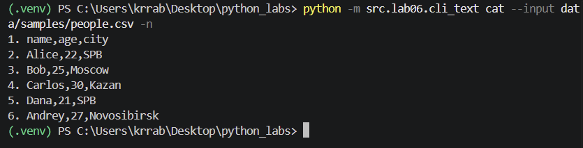


### Подкоманда stats

Считает общее число слов, число уникальных слов и выводит топ самых частых слов (по умолчанию 5).

Запуск топ 5:
``` python
py -m src.lab06.cli_text stats --input data/samples/text.txt --top 5
```
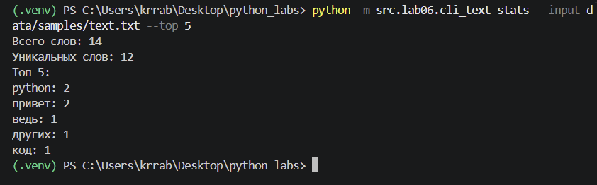

## Задание А - `cli_convert.py`
Утилита конвертирует данные между форматами JSON, CSV и XLSX. Сама конвертация выполняется функциями из ЛР5, а пути из терминала перед вызовом превращаются в объекты Path.
```python
"""CLI-конвертеры данных: json2csv, csv2json, csv2xlsx.

Запуск:
    python -m src.lab06.cli_convert json2csv --in data/samples/people.json --out data/out/people.csv
    python -m src.lab06.cli_convert csv2json --in data/samples/people.csv --out data/out/people.json
    python -m src.lab06.cli_convert csv2xlsx --in data/samples/people.csv --out data/out/people.xlsx
"""
import argparse

from src.lab05.json_csv import json_to_csv, csv_to_json
from src.lab05.csv_xlsx import csv_to_xlsx


def main() -> None:
    parser = argparse.ArgumentParser(description="Конвертеры данных (JSON, CSV, XLSX)")
    sub = parser.add_subparsers(dest="cmd")

    p1 = sub.add_parser("json2csv", help="Конвертировать JSON в CSV")
    p1.add_argument("--in", dest="input", required=True, help="Входной .json файл")
    p1.add_argument("--out", dest="output", required=True, help="Выходной .csv файл")

    p2 = sub.add_parser("csv2json", help="Конвертировать CSV в JSON")
    p2.add_argument("--in", dest="input", required=True, help="Входной .csv файл")
    p2.add_argument("--out", dest="output", required=True, help="Выходной .json файл")

    p3 = sub.add_parser("csv2xlsx", help="Конвертировать CSV в XLSX")
    p3.add_argument("--in", dest="input", required=True, help="Входной .csv файл")
    p3.add_argument("--out", dest="output", required=True, help="Выходной .xlsx файл")

    args = parser.parse_args()

    if args.cmd is None:
        parser.error("нужно указать подкоманду: json2csv, csv2json или csv2xlsx")

    try:
        if args.cmd == "json2csv":
            json_to_csv(args.input, args.output)
        elif args.cmd == "csv2json":
            csv_to_json(args.input, args.output)
        elif args.cmd == "csv2xlsx":
            csv_to_xlsx(args.input, args.output)
        print(f"Готово: {args.input} -> {args.output}")
    except FileNotFoundError as e:
        print(f"Ошибка: файл не найден ({e})")
    except ValueError as e:
        print(f"Ошибка: {e}")


if __name__ == "__main__":
    main()
```
### json to csv
Конвертирует JSON в CSV.
```python
py -m src.lab06.cli_convert json2csv --in data/samples/people.json --out data/out/people.csv
```
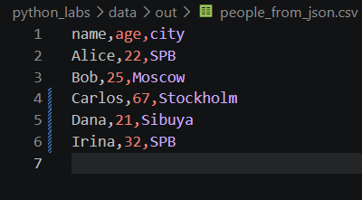

### csv to json
Конвертирует CSV в JSON.
```python
py -m src.lab06.cli_convert csv2json --in data/samples/people.csv --out data/out/people.json
```
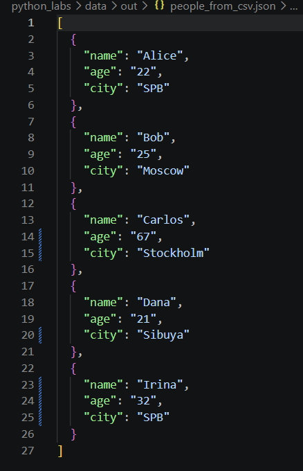

### csv to xlsx
Конвертирует CSV в XLSX.
```python
python -m src.lab06.cli_convert csv2xlsx --in data/samples/people.csv --out data/out/people.xlsx
```
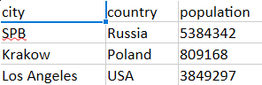

## Справка
### Общая справка 
Справка по cli_text:
```python
py -m src.lab06.cli_text --help
```

Справка по cli_convert:
```python
py -m src.lab06.cli_convert --help
```
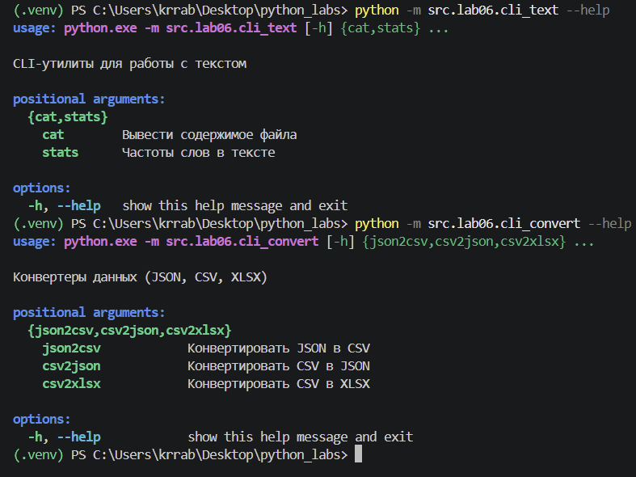

### Справка по подкомандам cli_text
Справка по `cat`:
```python
py -m src.lab06.cli_text cat --help
```
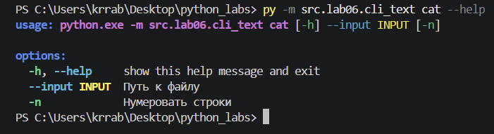

Справка по `stats`:
```python
py -m src.lab06.cli_text stats --help
```
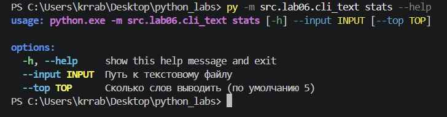

### Справка по подкомандам cli_convert:
Справка по json to csv:
```python
py -m src.lab06.cli_convert json2csv --help
```
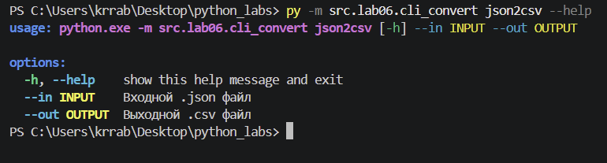

Справка по csv to json:
```python
py -m src.lab06.cli_convert csv2json --help
```
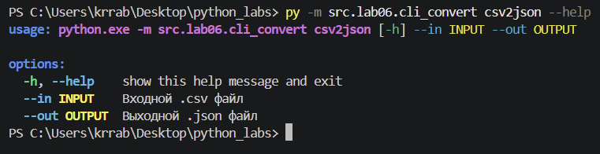

Справка по csv to xlsx:
```python
py -m src.lab06.cli_convert csv2xlsx --help
```
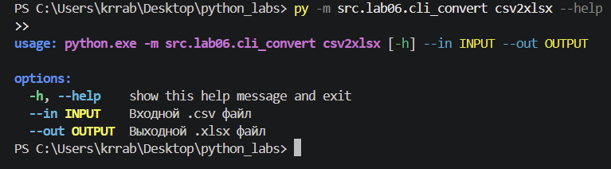

### Проверка ошибок
Если отсутствует один из обязательных аргументов (--input, --in или --out), модуль argparse автоматически сообщает об ошибке и показывает, какие параметры необходимо добавить.
```python
py -m src.lab06.cli_convert csv2json --in data/samples/people.csv
```
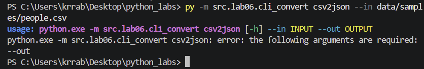

Для подкоманды stats реализована отдельная проверка параметра --top. Его значение должно быть положительным целым числом. Если указать ноль или отрицательное число, программа завершит выполнение команды и выведет соответствующее сообщение об ошибке.
```python
py -m src.lab06.cli_text stats --input data/samples/text.txt --top -4
```
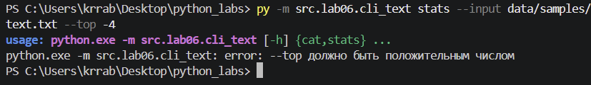