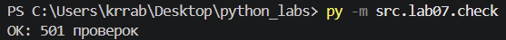
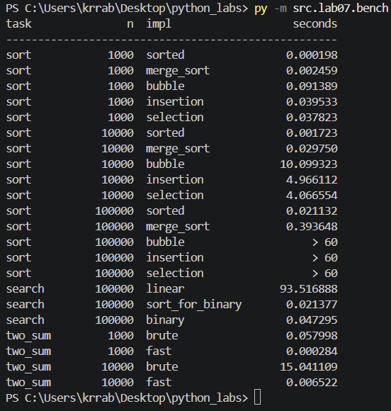
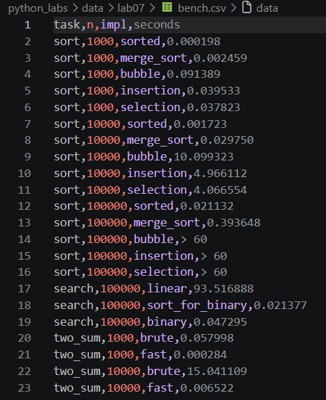

# Лабораторная №7

## Задание A — Поиск (`search.py`)

Требования:

- `linear_search` — индекс первого вхождения или `-1`.
- `binary_search` — работает только на отсортированном списке, цикл `while lo <= hi`.
- `two_sum_brute` — перебор пар, `O(n²)`.
- `two_sum_fast` — словарь «значение → индекс», один проход, `O(n)`.
- Без внешних пакетов.

```python
def linear_search(nums, x):
    """Индекс первого вхождения x или -1."""
    for i, v in enumerate(nums):
        if v == x:
            return i
    return -1


def binary_search(sorted_nums, x):
    """Индекс x в отсортированном по возрастанию списке или -1.
    На неотсортированном списке результат не определён."""
    lo, hi = 0, len(sorted_nums) - 1
    while lo <= hi:
        mid = (lo + hi) // 2
        if sorted_nums[mid] == x:
            return mid
        if sorted_nums[mid] < x:
            lo = mid + 1
        else:
            hi = mid - 1
    return -1


def two_sum_brute(nums, target):
    """Пара индексов (i, j), i < j, nums[i] + nums[j] == target, или None."""
    n = len(nums)
    for i in range(n):
        for j in range(i + 1, n):
            if nums[i] + nums[j] == target:
                return (i, j)
    return None


def two_sum_fast(nums, target):
    """То же, что two_sum_brute, но за один проход со словарём."""
    seen = {}
    for j, x in enumerate(nums):
        need = target - x
        if need in seen:
            return (seen[need], j)
        seen[x] = j
    return None
```

---

## Задание B — Сортировки (`sorting.py`)

Требования:

- Каждая функция возвращает **новый** список, исходный не меняется (`nums = list(nums)`).
- Без `sorted`, `.sort()`, `min`, `max` внутри.
- Пустой список и список из одного элемента работают.
- ★ В пузырьке — флаг «обменов не было» для раннего выхода.

```python
def bubble_sort(nums):
    a = list(nums)
    n = len(a)
    for end in range(n - 1, 0, -1):
        swapped = False
        for i in range(end):
            if a[i] > a[i + 1]:
                a[i], a[i + 1] = a[i + 1], a[i]
                swapped = True
        if not swapped:
            break
    return a


def insertion_sort(nums):
    a = list(nums)
    for i in range(1, len(a)):
        cur = a[i]
        j = i - 1
        while j >= 0 and a[j] > cur:
            a[j + 1] = a[j]
            j -= 1
        a[j + 1] = cur
    return a


def selection_sort(nums):
    a = list(nums)
    n = len(a)
    for i in range(n - 1):
        m = i
        for j in range(i + 1, n):
            if a[j] < a[m]:
                m = j
        a[i], a[m] = a[m], a[i]
    return a


def merge_sort(nums):
    """★ Снизу вверх, без рекурсии: сливаем отрезки длины 1, 2, 4, ..."""
    a = list(nums)
    n = len(a)
    width = 1
    while width < n:
        out = []
        for lo in range(0, n, 2 * width):
            mid = min(lo + width, n)
            hi = min(lo + 2 * width, n)
            i, j = lo, mid
            while i < mid and j < hi:
                if a[i] <= a[j]:
                    out.append(a[i]); i += 1
                else:
                    out.append(a[j]); j += 1
            out.extend(a[i:mid])
            out.extend(a[j:hi])
        a = out
        width *= 2
    return a
```

---

## Задание C — Проверка против эталона (`check.py`)

Требования:

- `check_sorting` — случайные списки длиной 0–50, значения −100…100, с повторами; сравнение с `sorted`, плюс проверка, что исходный список не изменён.
- `check_search` — `linear_search` против `list.index`; `binary_search` на отсортированных списках, включая отсутствующий `x` и крайние элементы.
- `check_two_sum` — оба способа дают пару с нужной суммой или оба `None`.
- При расхождении — `AssertionError` с данными, на которых разошлось.
- `random.seed(42)` — результаты воспроизводимы.

```python
import random
from src.lab07.search import (linear_search, binary_search,
                              two_sum_brute, two_sum_fast)
from src.lab07.sorting import bubble_sort, insertion_sort, selection_sort

COUNT = 0


def _rand_list(lo=-100, hi=100, max_n=50):
    n = random.randint(0, max_n)
    return [random.randint(lo, hi) for _ in range(n)]


def check_sorting(fn, trials=100):
    global COUNT
    for _ in range(trials):
        nums = _rand_list()
        original = list(nums)
        result = fn(nums)
        assert result == sorted(nums), f"{fn.__name__} ошиблась на {original}: {result}"
        assert nums == original, f"{fn.__name__} изменила исходный список {original}"
        COUNT += 1


def check_search(trials=100):
    global COUNT
    for _ in range(trials):
        nums = _rand_list()
        x = random.randint(-100, 100)
        try:
            expected = nums.index(x)
        except ValueError:
            expected = -1
        got = linear_search(nums, x)
        assert got == expected, f"linear_search({nums}, {x}) = {got}, ожидалось {expected}"

        s = sorted(nums)
        queries = [x]
        if s:
            queries += [s[0], s[-1], s[len(s) // 2]]
        for q in queries:
            idx = binary_search(s, q)
            if q in s:
                assert idx != -1 and s[idx] == q, f"binary_search({s}, {q}) = {idx}"
            else:
                assert idx == -1, f"binary_search({s}, {q}) = {idx}, ожидалось -1"
        COUNT += 1
    assert binary_search([], 5) == -1
    assert binary_search([5], 5) == 0
    assert binary_search([5], 4) == -1
    assert binary_search([1, 2], 2) == 1
    assert binary_search([1, 2], 1) == 0
    COUNT += 1


def _valid(nums, target, pair):
    i, j = pair
    return 0 <= i < j < len(nums) and nums[i] + nums[j] == target


def check_two_sum(trials=100):
    global COUNT
    for _ in range(trials):
        nums = _rand_list(-20, 20, 15)
        target = random.randint(-40, 40)
        a = two_sum_brute(nums, target)
        b = two_sum_fast(nums, target)
        assert (a is None) == (b is None), \
            f"two_sum разошлись на {nums}, target={target}: brute={a}, fast={b}"
        if a is not None:
            assert _valid(nums, target, a), f"brute неверна: {nums}, {target}, {a}"
            assert _valid(nums, target, b), f"fast неверна: {nums}, {target}, {b}"
        COUNT += 1


if __name__ == "__main__":
    random.seed(42)
    for fn in (bubble_sort, insertion_sort, selection_sort):
        check_sorting(fn)
    check_search()
    check_two_sum()
    print(f"OK: {COUNT} проверок")
```

### Примеры запуска

Запуск из корня проекта: `python -m src.lab07.check`

Результат:

```
OK: 501 проверок
```



---

## Задание D — Бенчмарк (`bench.py`)

Требования:

- Одни и те же случайные данные для всех алгоритмов, `random.seed(42)`.
- Сортировки: n = 1 000 / 10 000 / 100 000. Квадратичные на 10⁵ не запускаются, в таблице `> 60`.
- Поиск: список из 100 000 элементов, 10 000 запросов; время сортировки для бинарного поиска — отдельной строкой.
- Two Sum: n = 1 000 / 10 000, ответ гарантированно существует.
- Вывод — таблицей в консоль (f-строки) и в `data/lab07/bench.csv` через `write_csv` из ЛР4.

```python
import os
import random
import timeit

from src.lab04.io_txt_csv import write_csv
from src.lab07.search import (linear_search, binary_search,
                              two_sum_brute, two_sum_fast)
from src.lab07.sorting import (bubble_sort, insertion_sort,
                               selection_sort, merge_sort)

OUT = "data/lab07/bench.csv"
QUADRATIC_LIMIT = 10_000


def t(fn):
    return timeit.timeit(fn, number=1)


def bench_sorts(n):
    rows = []
    data = [random.randint(-10**6, 10**6) for _ in range(n)]
    rows.append(("sort", n, "sorted", t(lambda: sorted(data))))
    rows.append(("sort", n, "merge_sort", t(lambda: merge_sort(data))))
    for name, fn in (("bubble", bubble_sort),
                     ("insertion", insertion_sort),
                     ("selection", selection_sort)):
        if n > QUADRATIC_LIMIT:
            rows.append(("sort", n, name, "> 60"))
        else:
            rows.append(("sort", n, name, t(lambda: fn(data))))
    return rows


def bench_search(n=100_000, queries=10_000):
    data = [random.randint(0, 10**6) for _ in range(n)]
    qs = [random.randint(0, 10**6) for _ in range(queries)]
    rows = []

    def run_linear():
        for q in qs:
            linear_search(data, q)
    rows.append(("search", n, "linear", t(run_linear)))

    holder = {}
    rows.append(("search", n, "sort_for_binary",
                 t(lambda: holder.update(s=sorted(data)))))
    s = holder["s"]

    def run_binary():
        for q in qs:
            binary_search(s, q)
    rows.append(("search", n, "binary", t(run_binary)))
    return rows


def bench_two_sum(n):
    nums = [random.randint(0, 10**9) for _ in range(n)]
    target = nums[-2] + nums[-1]
    return [
        ("two_sum", n, "brute", t(lambda: two_sum_brute(nums, target))),
        ("two_sum", n, "fast", t(lambda: two_sum_fast(nums, target))),
    ]


def to_csv_rows(rows):
    return [(task, n, impl, sec if isinstance(sec, str) else f"{sec:.6f}")
            for task, n, impl, sec in rows]


def print_table(rows):
    print(f"{'task':<10}{'n':>10}  {'impl':<18}{'seconds':>12}")
    print("-" * 52)
    for task, n, impl, sec in rows:
        s = sec if isinstance(sec, str) else f"{sec:.6f}"
        print(f"{task:<10}{n:>10}  {impl:<18}{s:>12}")


if __name__ == "__main__":
    random.seed(42)
    rows = []
    for n in (1_000, 10_000, 100_000):
        rows += bench_sorts(n)
    rows += bench_search()
    for n in (1_000, 10_000):
        rows += bench_two_sum(n)

    print_table(rows)
    os.makedirs("data/lab07", exist_ok=True)
    write_csv(to_csv_rows(rows), OUT, header=("task", "n", "impl", "seconds"))
```

### Примеры запуска

Запуск из корня проекта: `python -m src.lab07.bench`

Результат в консоли:



Файл `data/lab07/bench.csv`:



### Таблица бенчмарка

Заполнить числами из `bench.csv`.

| task    | n      | impl            | seconds |
|---------|-------:|-----------------|--------:|
| sort    | 1000   | sorted          | 0.000198       |
| sort    | 1000   | merge_sort      | 0.002459       |
| sort    | 1000   | bubble          | 0.091389       |
| sort    | 1000   | insertion       | 0.039533       |
| sort    | 1000   | selection       | 0.037823       |
| sort    | 10000  | sorted          | 0.001723       |
| sort    | 10000  | merge_sort      | 0.029750       |
| sort    | 10000  | bubble          | 10.099323       |
| sort    | 10000  | insertion       | 4.966112       |
| sort    | 10000  | selection       | 4.066554       |
| sort    | 100000 | sorted          | 0.021132       |
| sort    | 100000 | merge_sort      | 0.393648       |
| sort    | 100000 | bubble          | > 60    |
| sort    | 100000 | insertion       | > 60    |
| sort    | 100000 | selection       | > 60    |
| search  | 100000 | linear          | 93.516888       |
| search  | 100000 | sort_for_binary | 0.021377       |
| search  | 100000 | binary          | 0.047295       |
| two_sum | 1000   | brute           | 0.057998       |
| two_sum | 1000   | fast            | 0.000284       |
| two_sum | 10000  | brute           | 15.041109       |
| two_sum | 10000  | fast            | 0.006522       |

---

## Выводы

### Почему пузырёк замедляется в ~100 раз, а `sorted` — в ~12.
Пузырёк делает порядка n² сравнений. При росте n в 10 раз число шагов растёт
в 10² = 100 раз, и секундомер это подтверждает: при переходе от n = 1 000
к n = 10 000 время выросло с 0.091389 с до 10.099323 с, то есть примерно в 100 раз.
`sorted` (Timsort) работает за O(n log n): n растёт в 10 раз, а log n — только
с ~10 до ~13–14, поэтому общий рост около 10 · 1,3 ≈ 12–13 раз `(у нас: ×12)`.
Для **n = 10⁵** квадратичные сортировки — это около 10¹⁰ шагов, то есть минуты,
поэтому в таблице стоит «> 60». `merge_sort` (★) растёт так же, как `sorted`
(O(n log n)), а не как пузырёк, хотя в абсолютных числах медленнее, потому что
написан на чистом Python, а `sorted` реализован на C.

### Почему бинарный поиск бесполезен без сортировки и когда она окупается.
Бинарный поиск сравнивает x с серединой и отбрасывает половину списка. Это
верно только если список упорядочен: на неотсортированном данных сравнение
с серединой ничего не говорит о том, в какой половине лежит x, поэтому
результат не определён. Сортировка стоит **O(n log n)**, но делается один раз.
При k запросах линейный поиск стоит k · n, а «сортировка + бинарный» —
`n log n + k log n`, так что сортировка окупается, когда запросов много.
В нашем замере (10 000 запросов к списку из 100 000 элементов) линейный поиск
занял `93.516888` с, сортировка — `0.021377` с, а все бинарные запросы вместе — `0.047295` с. Для одного-двух
запросов сортировка не имеет смысла: линейный проход дешевле.

### Что показал `check.py`.
Выполнено 501 проверка при `random.seed(42)`: по 100 прогонов для каждой из трёх
сортировок (300), 101 проверка поиска (100 случайных + граничные случаи) и 100
прогонов `check_two_sum`. Расхождения: *не найдены*
Программа завершилась сообщением `OK: 501 проверок`.
