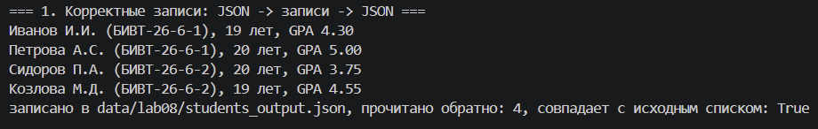
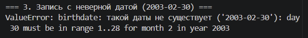
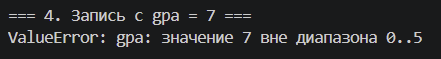

# Лабораторная №8

## Задание A — Модель Student (`models.py`)

Запись — словарь с ровно четырьмя ключами, их перечень хранится в константе `STUDENT_FIELDS`.

| Ключ        | Тип   | Правило                                                          |
|-------------|-------|------------------------------------------------------------------|
| `fio`       | `str` | после `strip()` непустая                                         |
| `birthdate` | `str` | строго `YYYY-MM-DD`, дата существует и не в будущем              |
| `group`     | `str` | после `strip()` непустая                                         |
| `gpa`       | `float` | число (`int` или `float`, не `bool`), `0 ≤ gpa ≤ 5`; `int` приводится к `float` |

```python
{"fio": "Иванов Иван Иванович", "birthdate": "2007-05-14", "group": "БИВТ-26-6-1", "gpa": 4.3}
```

Требования:

- Без `class` — только словари и функции.
- `make_student` — функция-конструктор: проверяет каждое поле, при ошибке `ValueError` с указанием поля и причины.
- `validate_student` — проверяет готовый словарь: `set(rec) == set(STUDENT_FIELDS)` и значения.
- `student_age` — полных лет на дату `today`; учитывается, был ли уже день рождения в этом году.
- `format_student` — вид `Иванов И.И. (БИВТ-26-6-1), 19 лет, GPA 4.30`.
- `student_to_dict` — копия записи (другой объект, не сам `rec`).
- `student_from_dict` — ровно нужные ключи, `gpa` → `float`, валидация.
- Дата: регулярка проверяет формат, `date.fromisoformat` — существование (`2003-02-30` проходит по формату, но даты нет).
- ★ `update_student` — возвращает новую запись, исходная не меняется.

```python
"""ЛР8: модель Student как словарь с фиксированным набором ключей.

В модуле нет классов: запись — обычный dict, а все операции над ней —
функции. Любая функция может положиться на константу STUDENT_FIELDS.
"""

import re
from datetime import date

STUDENT_FIELDS = ("fio", "birthdate", "group", "gpa")

# Строго YYYY-MM-DD: date.fromisoformat в Python 3.11+ принимает и другие
# ISO-форматы (например, 20030215), поэтому формат проверяем отдельно.
_DATE_RE = re.compile(r"^\d{4}-\d{2}-\d{2}$")


# ---------------------------------------------------------------- проверки полей

def _check_text(field, value):
    """fio и group: строка, после strip() непустая."""
    if not isinstance(value, str):
        raise ValueError(
            f"{field}: ожидается строка, получено {type(value).__name__}"
        )
    if not value.strip():
        raise ValueError(f"{field}: строка не должна быть пустой")


def _check_birthdate(value):
    """birthdate: строка YYYY-MM-DD, дата существует и не в будущем."""
    if not isinstance(value, str):
        raise ValueError(
            f"birthdate: ожидается строка, получено {type(value).__name__}"
        )
    if not _DATE_RE.match(value):
        raise ValueError(
            f"birthdate: неверный формат {value!r}, ожидается YYYY-MM-DD"
        )
    try:
        born = date.fromisoformat(value)
    except ValueError as e:
        raise ValueError(f"birthdate: такой даты не существует ({value!r}): {e}")
    if born > date.today():
        raise ValueError(f"birthdate: дата {value!r} в будущем")


def _check_gpa(value):
    """gpa: int или float (не bool), 0 <= gpa <= 5."""
    # bool — подкласс int, поэтому проверяем его первым
    if isinstance(value, bool) or not isinstance(value, (int, float)):
        raise ValueError(
            f"gpa: ожидается число, получено {type(value).__name__} ({value!r})"
        )
    if not (0 <= value <= 5):  # для nan условие тоже ложно
        raise ValueError(f"gpa: значение {value!r} вне диапазона 0..5")


def _check_values(fio, birthdate, group, gpa):
    _check_text("fio", fio)
    _check_birthdate(birthdate)
    _check_text("group", group)
    _check_gpa(gpa)


# ---------------------------------------------------------------- основные функции

def make_student(fio, birthdate, group, gpa):
    """Функция-конструктор: проверяет каждое поле и собирает запись."""
    _check_values(fio, birthdate, group, gpa)
    return {
        "fio": fio.strip(),
        "birthdate": birthdate,
        "group": group.strip(),
        "gpa": float(gpa),
    }


def validate_student(rec):
    """Проверяет готовый словарь: набор ключей и значения.

    При любой проблеме — ValueError. Ничего не возвращает.
    """
    if not isinstance(rec, dict):
        raise ValueError(f"запись должна быть словарём, получено {type(rec).__name__}")

    keys = set(rec)
    expected = set(STUDENT_FIELDS)
    if keys != expected:
        problems = []
        missing = sorted(expected - keys)
        extra = sorted(keys - expected, key=str)
        if missing:
            problems.append(f"нет ключей: {', '.join(missing)}")
        if extra:
            problems.append(f"лишние ключи: {', '.join(map(str, extra))}")
        raise ValueError("набор ключей не совпадает с STUDENT_FIELDS — " + "; ".join(problems))

    _check_values(rec["fio"], rec["birthdate"], rec["group"], rec["gpa"])


def student_age(rec, today=None):
    """Полных лет на дату today (по умолчанию — сегодня)."""
    validate_student(rec)
    today = today or date.today()
    born = date.fromisoformat(rec["birthdate"])
    if today < born:
        raise ValueError(f"дата {today} раньше даты рождения {born}")
    # если в этом году день рождения ещё не наступил — вычитаем год
    had_birthday = (today.month, today.day) >= (born.month, born.day)
    return today.year - born.year - (0 if had_birthday else 1)


def _short_fio(fio):
    """'Иванов Иван Иванович' -> 'Иванов И.И.' (инициалы из ЛР1)."""
    parts = fio.split()
    surname, rest = parts[0], parts[1:]
    initials = "".join(p[0].upper() + "." for p in rest)
    return f"{surname} {initials}".strip()


def _years_word(n):
    """Правильная форма слова: 1 год, 2 года, 5 лет, 11 лет, 21 год."""
    if 11 <= n % 100 <= 14:
        return "лет"
    last = n % 10
    if last == 1:
        return "год"
    if 2 <= last <= 4:
        return "года"
    return "лет"


def format_student(rec):
    """Красивый вывод: Иванов И.И. (БИВТ-26-6-1), 19 лет, GPA 4.30"""
    validate_student(rec)
    age = student_age(rec)
    return (
        f"{_short_fio(rec['fio'])} ({rec['group']}), "
        f"{age} {_years_word(age)}, GPA {rec['gpa']:.2f}"
    )


def student_to_dict(rec):
    """Копия записи для сериализации (это другой объект, а не сам rec)."""
    validate_student(rec)
    return {key: rec[key] for key in STUDENT_FIELDS}


def student_from_dict(d):
    """Десериализация: берём ровно нужные ключи, gpa -> float, валидируем.

    Лишние ключи во входном словаре игнорируются, отсутствующие — ошибка.
    """
    if not isinstance(d, dict):
        raise ValueError(f"запись должна быть объектом, получено {type(d).__name__}")
    missing = [key for key in STUDENT_FIELDS if key not in d]
    if missing:
        raise ValueError(f"нет ключей: {', '.join(missing)}")

    rec = {key: d[key] for key in STUDENT_FIELDS}
    # int -> float; bool и строки не трогаем, их отловит validate_student
    if isinstance(rec["gpa"], int) and not isinstance(rec["gpa"], bool):
        rec["gpa"] = float(rec["gpa"])
    validate_student(rec)
    return rec


# ---------------------------------------------------------------- ★ дополнительное

def update_student(rec, **fields):
    """Возвращает НОВУЮ запись с изменёнными полями; rec не меняется.

    Неизвестный ключ — KeyError, неверное значение — ValueError.
    """
    unknown = [key for key in fields if key not in STUDENT_FIELDS]
    if unknown:
        raise KeyError(f"неизвестные поля: {', '.join(unknown)}")
    new_rec = dict(rec)       # копия, чтобы не трогать исходную запись
    new_rec.update(fields)
    return student_from_dict(new_rec)  # внутри — validate_student
```

---

## Задание B — Сериализация (`serialize.py`)

Требования:

- `students_to_json` — массив объектов, `ensure_ascii=False`, `indent=2`, UTF-8.
- `students_from_json` — читает JSON-массив, каждую запись прогоняет через `student_from_dict`.
- Если файл не JSON или в корне не массив — `ValueError`.
- ★ `students_from_csv` — чтение через `csv.DictReader` (заголовок `fio,birthdate,group,gpa`).

### Политика обработки битых записей

**Выбрана политика `strict`** (по умолчанию): первая же битая запись останавливает загрузку с `ValueError`, в сообщении — имя файла, номер записи (с единицы) и причина. Программа, которая молча продолжает работать с частью данных, хуже программы, которая упала.

Политика `skip` тоже реализована (`policy="skip"`): битые записи пропускаются, в конце в консоль выводится, сколько записей пропущено и почему. Нужна для демонстрации и для случаев, где потеря части данных допустима.

### Где лечится `gpa` из CSV

Из CSV все значения приходят строками, поэтому `gpa` приводится к `float` в `students_from_csv`, на границе чтения файла (запятая как разделитель дроби тоже допускается). `student_from_dict` остаётся строгим: строку вместо числа он не примет, поэтому и запись `"gpa": "4.5"` в JSON будет отвергнута. Если в `gpa` не число, строка передаётся дальше как есть, и `student_from_dict` сообщает причину.

```python
"""ЛР8: сериализация записей Student в JSON и обратно (+ ★ чтение из CSV)."""

import csv
import json

from src.lab08.models import student_from_dict, student_to_dict

# Выбранная политика обработки битых записей (см. README):
#   "strict" — первая же ошибка -> ValueError с номером записи и причиной
#   "skip"   — битые записи пропускаются, в конце печатается отчёт
DEFAULT_POLICY = "strict"


def students_to_json(students, path):
    """Сохраняет список записей в JSON: массив объектов."""
    data = [student_to_dict(s) for s in students]  # заодно валидирует
    with open(path, "w", encoding="utf-8") as f:
        json.dump(data, f, ensure_ascii=False, indent=2)
        f.write("\n")


def _convert_all(items, policy, source):
    """Прогоняет сырые словари через student_from_dict по выбранной политике."""
    if policy not in ("strict", "skip"):
        raise ValueError(f"неизвестная политика {policy!r}, нужна 'strict' или 'skip'")

    students = []
    skipped = []  # пары (номер записи, причина)
    for number, item in enumerate(items, start=1):
        try:
            students.append(student_from_dict(item))
        except ValueError as e:
            if policy == "strict":
                raise ValueError(f"{source}: запись №{number}: {e}") from e
            skipped.append((number, str(e)))

    if skipped:
        print(f"{source}: пропущено записей: {len(skipped)}")
        for number, reason in skipped:
            print(f"  запись №{number}: {reason}")
    return students


def students_from_json(path, policy=DEFAULT_POLICY):
    """Читает JSON-массив и превращает каждую запись в валидный Student."""
    with open(path, encoding="utf-8") as f:
        try:
            data = json.load(f)
        except json.JSONDecodeError as e:  # подкласс ValueError
            raise ValueError(f"{path}: некорректный JSON: {e}") from e
    if not isinstance(data, list):
        raise ValueError(f"{path}: ожидается JSON-массив записей")
    return _convert_all(data, policy, str(path))


def students_from_csv(path, policy=DEFAULT_POLICY):
    """★ Читает записи из CSV с заголовком fio,birthdate,group,gpa.

    Из CSV все значения приходят строками, поэтому gpa приводится к float
    именно здесь, на границе чтения файла. student_from_dict остаётся
    строгим: строку вместо числа он не примет.
    """
    with open(path, encoding="utf-8", newline="") as f:
        rows = []
        for row in csv.DictReader(f):
            row = dict(row)
            raw = row.get("gpa")
            if isinstance(raw, str):
                try:
                    row["gpa"] = float(raw.replace(",", "."))
                except ValueError:
                    pass  # оставляем строку: student_from_dict сообщит причину
            rows.append(row)
    return _convert_all(rows, policy, str(path))
```

---

## Задание C — Демонстрация (`demo.py`)

Требования:

- Корректные записи туда-обратно: JSON → записи → JSON, результат совпадает с исходным списком.
- `student_age` для человека, родившегося 2007-09-20: на 2026-09-19 ещё 18, на 2026-09-20 уже 19.
- Запись с неверной датой (`2003-02-30`) и запись с `gpa = 7` — `ValueError`.
- `validate_student` на словарях с лишним и недостающим ключом.
- Битый файл под обеими политиками, `strict` и `skip`.
- ★ `update_student` не меняет исходную запись, `students_from_csv` даёт `gpa` типа `float`.

```python
"""Демонстрация ЛР8. Запуск из корня репозитория: python -m src.lab08.demo"""

from datetime import date

from src.lab08.models import (
    format_student,
    make_student,
    student_age,
    update_student,
    validate_student,
)
from src.lab08.serialize import (
    students_from_csv,
    students_from_json,
    students_to_json,
)

INPUT = "data/lab08/students_input.json"
OUTPUT = "data/lab08/students_output.json"
BAD = "data/lab08/students_bad.json"
CSV = "data/lab08/students.csv"


def section(title):
    print(f"\n=== {title} ===")


def main():
    section("1. Корректные записи: JSON -> записи -> JSON")
    students = students_from_json(INPUT)
    for s in students:
        print(format_student(s))
    students_to_json(students, OUTPUT)
    again = students_from_json(OUTPUT)
    print(f"записано в {OUTPUT}, прочитано обратно: {len(again)}, "
          f"совпадает с исходным списком: {again == students}")

    section("2. student_age: день рождения 2007-09-20")
    rec = make_student("Козлова Мария Дмитриевна", "2007-09-20", "БИВТ-26-6-2", 4.55)
    print("на 2026-09-19:", student_age(rec, date(2026, 9, 19)))
    print("на 2026-09-20:", student_age(rec, date(2026, 9, 20)))

    section("3. Запись с неверной датой (2003-02-30)")
    try:
        make_student("Смирнов Олег Игоревич", "2003-02-30", "БИВТ-26-6-1", 4.0)
    except ValueError as e:
        print("ValueError:", e)

    section("4. Запись с gpa = 7")
    try:
        make_student("Орлова Екатерина Павловна", "2006-08-01", "БИВТ-26-6-2", 7)
    except ValueError as e:
        print("ValueError:", e)

    section("5. validate_student: лишний и недостающий ключ")
    for bad in (
        {"fio": "А Б В", "birthdate": "2006-01-01", "group": "Г", "gpa": 4, "email": "x"},
        {"fio": "А Б В", "birthdate": "2006-01-01", "gpa": 4},
    ):
        try:
            validate_student(bad)
        except ValueError as e:
            print("ValueError:", e)

    section("6. Битый файл, политика strict (по умолчанию)")
    try:
        students_from_json(BAD)
    except ValueError as e:
        print("ValueError:", e)

    section("7. Битый файл, политика skip")
    good = students_from_json(BAD, policy="skip")
    print("загружено валидных записей:", len(good))

    section("8. ★ update_student не меняет исходную запись")
    s1 = students[0]
    s2 = update_student(s1, gpa=4.8)
    print("s1['gpa'] =", s1["gpa"], "| s2['gpa'] =", s2["gpa"], "| один объект:", s1 is s2)
    for kwargs in ({"email": "x"}, {"gpa": 9}):
        try:
            update_student(s1, **kwargs)
        except (KeyError, ValueError) as e:
            print(f"{type(e).__name__}:", e)

    section("9. ★ students_from_csv")
    for s in students_from_csv(CSV):
        print(format_student(s), "| тип gpa:", type(s["gpa"]).__name__)


if __name__ == "__main__":
    main()
```

### Примеры запуска

Запуск из корня проекта: `python -m src.lab08.demo`

Результат:

```

=== 1. Корректные записи: JSON -> записи -> JSON ===
Иванов И.И. (БИВТ-26-6-1), 19 лет, GPA 4.30
Петрова А.С. (БИВТ-26-6-1), 20 лет, GPA 5.00
Сидоров П.А. (БИВТ-26-6-2), 20 лет, GPA 3.75
Козлова М.Д. (БИВТ-26-6-2), 19 лет, GPA 4.55
записано в data/lab08/students_output.json, прочитано обратно: 4, совпадает с исходным списком: True

=== 2. student_age: день рождения 2007-09-20 ===
на 2026-09-19: 18
на 2026-09-20: 19

=== 3. Запись с неверной датой (2003-02-30) ===
ValueError: birthdate: такой даты не существует ('2003-02-30'): day is out of range for month

=== 4. Запись с gpa = 7 ===
ValueError: gpa: значение 7 вне диапазона 0..5

=== 5. validate_student: лишний и недостающий ключ ===
ValueError: набор ключей не совпадает с STUDENT_FIELDS — лишние ключи: email
ValueError: набор ключей не совпадает с STUDENT_FIELDS — нет ключей: group

=== 6. Битый файл, политика strict (по умолчанию) ===
ValueError: data/lab08/students_bad.json: запись №2: birthdate: такой даты не существует ('2003-02-30'): day is out of range for month

=== 7. Битый файл, политика skip ===
data/lab08/students_bad.json: пропущено записей: 4
  запись №2: birthdate: такой даты не существует ('2003-02-30'): day is out of range for month
  запись №3: gpa: значение 7.0 вне диапазона 0..5
  запись №4: нет ключей: group
  запись №5: gpa: ожидается число, получено bool (True)
загружено валидных записей: 1

=== 8. ★ update_student не меняет исходную запись ===
s1['gpa'] = 4.3 | s2['gpa'] = 4.8 | один объект: False
KeyError: 'неизвестные поля: email'
ValueError: gpa: значение 9.0 вне диапазона 0..5

=== 9. ★ students_from_csv ===
Морозов А.В. (БИВТ-26-6-1), 20 лет, GPA 4.20 | тип gpa: float
Белова Д.О. (БИВТ-26-6-2), 19 лет, GPA 3.90 | тип gpa: float
```

Корректные записи туда-обратно:



Запись с неверной датой:



Запись с `gpa = 7`:



---

## Файлы данных

`data/lab08/students_input.json` — входной файл. У Петровой `gpa` целое число `5`, у остальных дробное:

```json
[
  {
    "fio": "Иванов Иван Иванович",
    "birthdate": "2007-05-14",
    "group": "БИВТ-26-6-1",
    "gpa": 4.3
  },
  {
    "fio": "Петрова Анна Сергеевна",
    "birthdate": "2006-03-12",
    "group": "БИВТ-26-6-1",
    "gpa": 5
  },
  {
    "fio": "Сидоров Пётр Алексеевич",
    "birthdate": "2005-11-30",
    "group": "БИВТ-26-6-2",
    "gpa": 3.75
  },
  {
    "fio": "Козлова Мария Дмитриевна",
    "birthdate": "2007-09-20",
    "group": "БИВТ-26-6-2",
    "gpa": 4.55
  }
]
```

`data/lab08/students_output.json` — результат сериализации. После чтения и записи `gpa` везде `float` (у Петровой `5` стало `5.0`), порядок ключей фиксирован:

```json
[
  {
    "fio": "Иванов Иван Иванович",
    "birthdate": "2007-05-14",
    "group": "БИВТ-26-6-1",
    "gpa": 4.3
  },
  {
    "fio": "Петрова Анна Сергеевна",
    "birthdate": "2006-03-12",
    "group": "БИВТ-26-6-1",
    "gpa": 5.0
  },
  {
    "fio": "Сидоров Пётр Алексеевич",
    "birthdate": "2005-11-30",
    "group": "БИВТ-26-6-2",
    "gpa": 3.75
  },
  {
    "fio": "Козлова Мария Дмитриевна",
    "birthdate": "2007-09-20",
    "group": "БИВТ-26-6-2",
    "gpa": 4.55
  }
]
```

`data/lab08/students_bad.json` — файл с битыми записями, из пяти валидна только первая:

| №   | Проблема                                   |
|-----|--------------------------------------------|
| 2   | `birthdate = "2003-02-30"` — такой даты нет |
| 3   | `gpa = 7` — вне диапазона 0..5             |
| 4   | нет ключа `group`                          |
| 5   | `gpa = true` — `bool` не считается числом  |

```json
[
  {
    "fio": "Иванов Иван Иванович",
    "birthdate": "2007-05-14",
    "group": "БИВТ-26-6-1",
    "gpa": 4.3
  },
  {
    "fio": "Смирнов Олег Игоревич",
    "birthdate": "2003-02-30",
    "group": "БИВТ-26-6-1",
    "gpa": 4.0
  },
  {
    "fio": "Орлова Екатерина Павловна",
    "birthdate": "2006-08-01",
    "group": "БИВТ-26-6-2",
    "gpa": 7
  },
  {
    "fio": "Новиков Дмитрий Андреевич",
    "birthdate": "2006-01-17",
    "gpa": 4.1
  },
  {
    "fio": "Волкова Ольга Николаевна",
    "birthdate": "2005-12-05",
    "group": "БИВТ-26-6-2",
    "gpa": true
  }
]
```

---

## Выводы

### Чем запись-словарь отличается от «просто словаря».
Ключи записи не произвольны: их перечень зафиксирован в `STUDENT_FIELDS`, и любая
функция может на него положиться. Записи не собирают руками в каждом месте —
это делает одна функция-конструктор, которая заодно проверяет данные. Поэтому
в программе не появляются записи с неверной датой или `gpa = 7`: проверка
выполняется при создании, при десериализации и при обновлении записи.

### Почему дату нельзя проверять одной регуляркой.
Регулярка `^\d{4}-\d{2}-\d{2}$` проверяет только форму: `2003-02-30` ей
соответствует, но такой даты не существует. Поэтому после регулярки строку
разбирает `date.fromisoformat`, и на `2003-02-30` он даёт
`ValueError: day is out of range for month`. Регулярка нужна, потому что
`fromisoformat` в Python 3.11+ принимает и другие ISO-форматы, например
`20030215`, а по заданию допустим только `YYYY-MM-DD`.

### Почему `strict` лучше, чем `skip`.
При `strict` ошибка в данных видна сразу: сообщение называет файл, номер записи
и причину. В демонстрации это `запись №2: birthdate: такой даты не существует`.
При `skip` из `students_bad.json` загружается одна запись из пяти, а остальные
четыре молча выпадают из выборки, поэтому программа считает по неполным данным.
Лучше упасть и исправить файл, чем продолжать работать с неверным набором данных.

### Зачем функции возвращают новую запись.
Два имени могут указывать на один словарь, и изменение через одно имя видно
через другое (см. ЛР3). `update_student` делает копию `dict(rec)`, меняет копию
и прогоняет её через `student_from_dict`. В демонстрации `s1['gpa']` остаётся
`4.3`, а `s2['gpa']` равно `4.8`, и `s1 is s2` даёт `False`. По той же причине
`student_to_dict` возвращает копию, а не сам `rec`.

### Что показал запуск.
Все сценарии из `demo.py` отработали без непредвиденных ошибок: четыре
корректные записи прошли путь JSON → записи → JSON и совпали с исходным
списком, `student_age` правильно учёл день рождения (18 на 2026-09-19 и 19
на 2026-09-20), а неверная дата, `gpa = 7`, лишний и недостающий ключ были
отвергнуты с понятными сообщениями. Во втором семестре эта запись станет
классом: функции превратятся в методы, а `STUDENT_FIELDS` — в атрибуты.