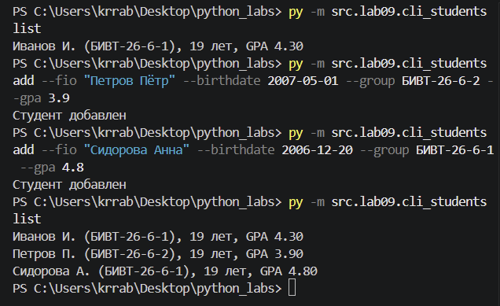
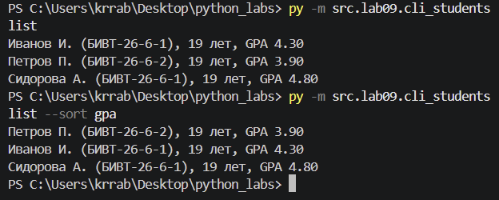
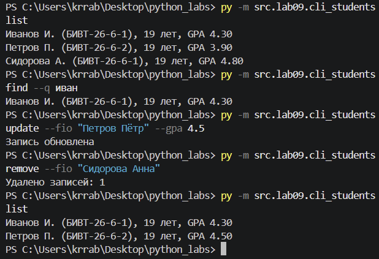
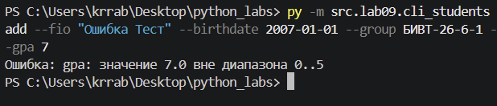
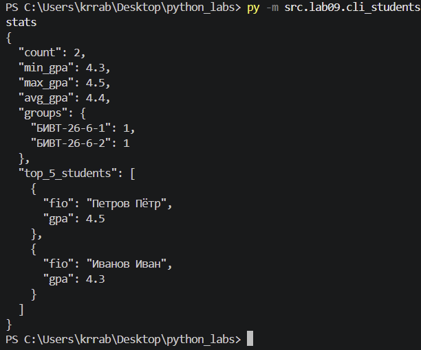

# Лабораторная №9 — «База данных» на CSV: CRUD-функции и CLI

Хранилище студентов в `data/lab09/students.csv`. Все операции — функции, первым аргументом которых идёт путь к файлу `path` (общее состояние передаётся явно). Классов нет. Используются `Student` из ЛР8 (`student_from_dict`, `validate_student`, `format_student`) и `argparse` из ЛР6.


## Задание A — Хранилище и CRUD (group.py)

Требования:

- `ensure_storage` — создать каталоги и файл с заголовком `fio,birthdate,group,gpa`, если файла нет.
- `load_students` — `csv.DictReader`, каждая строка через `student_from_dict`; неверный заголовок или лишние колонки — `ValueError`.
- `save_students` — `csv.DictWriter`, `newline=""`, `encoding="utf-8"`.
- Изменяющие операции (add, remove, update): **загрузить → изменить → сохранить**.
- `list_students(sort_by)` — `None`, `"fio"` или `"gpa"`, иначе `ValueError`.
- `find_students` — подстрока в ФИО без учёта регистра.
- `remove_student` — удаляет все записи с таким ФИО, возвращает количество.
- `update_student` — обновляет первую найденную запись, неизвестный ключ — `KeyError`, результат валидируется, возвращает `True/False`.
- ★ `stats(path)` и запрет дубликатов в `add_student`.

```python
import csv
from pathlib import Path

from src.lab08.models import STUDENT_FIELDS, student_from_dict, validate_student

HEADER = list(STUDENT_FIELDS)  # ["fio", "birthdate", "group", "gpa"]


def _prepare(d):
    """Копия записи, где gpa-строка (из CSV или CLI) переведена в float.

    student_from_dict из ЛР8 строки не конвертирует, поэтому делаем это здесь.
    """
    d = dict(d)
    g = d.get("gpa")
    if isinstance(g, str):
        try:
            d["gpa"] = float(g.strip().replace(",", "."))
        except ValueError:
            raise ValueError(f"gpa: ожидается число, получено {g!r}")
    return d


def ensure_storage(path):
    path = Path(path)
    path.parent.mkdir(parents=True, exist_ok=True)
    if not path.exists():
        with path.open("w", newline="", encoding="utf-8") as f:
            csv.writer(f).writerow(HEADER)


def load_students(path):
    ensure_storage(path)
    with Path(path).open("r", newline="", encoding="utf-8-sig") as f:
        reader = csv.DictReader(f)
        if reader.fieldnames is None or list(reader.fieldnames) != HEADER:
            raise ValueError(
                f"Неверный или отсутствующий заголовок CSV, ожидается: {','.join(HEADER)}"
            )
        students = []
        for line_no, row in enumerate(reader, start=2):
            if None in row or None in row.values():
                raise ValueError(f"Строка {line_no}: неверное число колонок")
            try:
                students.append(student_from_dict(_prepare(row)))
            except ValueError as e:
                raise ValueError(f"Строка {line_no}: {e}")
    return students


def save_students(path, students):
    ensure_storage(path)
    with Path(path).open("w", newline="", encoding="utf-8") as f:
        writer = csv.DictWriter(f, fieldnames=HEADER)
        writer.writeheader()
        writer.writerows(students)


def add_student(path, student):
    rec = student_from_dict(_prepare(student))
    validate_student(rec)
    students = load_students(path)
    if any(s["fio"] == rec["fio"] for s in students):
        raise ValueError(f"Студент с ФИО {rec['fio']!r} уже существует")
    students.append(rec)
    save_students(path, students)


def list_students(path, sort_by=None):
    students = load_students(path)
    if sort_by is None:
        return students
    if sort_by == "fio":
        return sorted(students, key=lambda s: s["fio"].lower())
    if sort_by == "gpa":
        return sorted(students, key=lambda s: s["gpa"])
    raise ValueError(
        f"Неизвестное значение sort_by: {sort_by!r} (допустимо: None, 'fio', 'gpa')"
    )


def find_students(path, substr):
    needle = substr.lower()
    return [s for s in load_students(path) if needle in s["fio"].lower()]


def remove_student(path, fio):
    students = load_students(path)
    kept = [s for s in students if s["fio"] != fio]
    removed = len(students) - len(kept)
    if removed:
        save_students(path, kept)
    return removed


def update_student(path, fio, **fields):
    for key in fields:
        if key not in HEADER:
            raise KeyError(f"Неизвестное поле: {key}")
    students = load_students(path)
    for i, s in enumerate(students):
        if s["fio"] == fio:
            updated = student_from_dict(_prepare({**s, **fields}))
            validate_student(updated)
            students[i] = updated
            save_students(path, students)
            return True
    return False


def stats(path):
    students = load_students(path)
    if not students:
        return {"count": 0, "min_gpa": None, "max_gpa": None,
                "avg_gpa": None, "groups": {}, "top_5_students": []}
    gpas = [s["gpa"] for s in students]
    groups = {}
    for s in students:
        groups[s["group"]] = groups.get(s["group"], 0) + 1
    top = sorted(students, key=lambda s: s["gpa"], reverse=True)[:5]
    return {
        "count": len(students),
        "min_gpa": min(gpas),
        "max_gpa": max(gpas),
        "avg_gpa": round(sum(gpas) / len(gpas), 2),
        "groups": groups,
        "top_5_students": [{"fio": s["fio"], "gpa": s["gpa"]} for s in top],
    }
```

## Задание B — CLI (cli_students.py)

Требования:

- Подкоманды `add`, `list [--sort fio|gpa]`, `find --q`, `remove --fio`, `update --fio [--gpa] [--group] [--birthdate]`, ★ `stats`.
- Общий параметр `--db` (по умолчанию `data/lab09/students.csv`).
- Список выводится через `format_student` из ЛР8.
- Ошибки валидации — понятным текстом в stderr и код возврата 1.

```python
import argparse
import json
import sys

from src.lab08.models import format_student
from src.lab09 import group

DEFAULT_DB = "data/lab09/students.csv"


def build_parser():
    common = argparse.ArgumentParser(add_help=False)
    common.add_argument("--db", default=DEFAULT_DB, help="путь к CSV-хранилищу")

    parser = argparse.ArgumentParser(description="CRUD над students.csv")
    sub = parser.add_subparsers(dest="cmd", required=True)

    p = sub.add_parser("add", parents=[common], help="добавить студента")
    p.add_argument("--fio", required=True)
    p.add_argument("--birthdate", required=True)
    p.add_argument("--group", required=True)
    p.add_argument("--gpa", required=True)

    p = sub.add_parser("list", parents=[common], help="вывести список")
    p.add_argument("--sort", choices=["fio", "gpa"])

    p = sub.add_parser("find", parents=[common], help="поиск по ФИО")
    p.add_argument("--q", required=True, help="подстрока")

    p = sub.add_parser("remove", parents=[common], help="удалить по ФИО")
    p.add_argument("--fio", required=True)

    p = sub.add_parser("update", parents=[common], help="обновить запись")
    p.add_argument("--fio", required=True)
    p.add_argument("--gpa")
    p.add_argument("--group")
    p.add_argument("--birthdate")

    sub.add_parser("stats", parents=[common], help="статистика по группе")
    return parser


def run(args):
    db = args.db
    if args.cmd == "add":
        group.add_student(db, {"fio": args.fio, "birthdate": args.birthdate,
                               "group": args.group, "gpa": args.gpa})
        print("Студент добавлен")
    elif args.cmd == "list":
        for s in group.list_students(db, args.sort):
            print(format_student(s))
    elif args.cmd == "find":
        for s in group.find_students(db, args.q):
            print(format_student(s))
    elif args.cmd == "remove":
        print(f"Удалено записей: {group.remove_student(db, args.fio)}")
    elif args.cmd == "update":
        fields = {k: v for k, v in (("gpa", args.gpa), ("group", args.group),
                                    ("birthdate", args.birthdate)) if v is not None}
        if not fields:
            raise ValueError("Укажите хотя бы одно поле для обновления")
        if group.update_student(db, args.fio, **fields):
            print("Запись обновлена")
        else:
            print(f"Студент {args.fio!r} не найден", file=sys.stderr)
            return 1
    elif args.cmd == "stats":
        print(json.dumps(group.stats(db), ensure_ascii=False, indent=2))
    return 0


def main(argv=None):
    args = build_parser().parse_args(argv)
    try:
        return run(args)
    except (ValueError, KeyError) as e:
        print(f"Ошибка: {e}", file=sys.stderr)
        return 1


if __name__ == "__main__":
    sys.exit(main())
```

## Примеры запуска

Запуск из корня проекта: `python -m src.lab09.cli_students <команда>`

Исходный `students.csv`:

```csv
fio,birthdate,group,gpa
Иванов Иван,2007-10-10,БИВТ-26-6-1,4.3
```

### Сценарий из 9 команд подряд

```
> py -m src.lab09.cli_students list
Иванов И. (БИВТ-26-6-1), 19 лет, GPA 4.30

> py -m src.lab09.cli_students add --fio "Петров Пётр" --birthdate 2007-05-01 --group БИВТ-26-6-2 --gpa 3.9
Студент добавлен

> py -m src.lab09.cli_students add --fio "Сидорова Анна" --birthdate 2006-12-20 --group БИВТ-26-6-1 --gpa 4.8
Студент добавлен

> py -m src.lab09.cli_students list --sort gpa
Петров П. (БИВТ-26-6-2), 19 лет, GPA 3.90
Иванов И. (БИВТ-26-6-1), 19 лет, GPA 4.30
Сидорова А. (БИВТ-26-6-1), 19 лет, GPA 4.80

> py -m src.lab09.cli_students find --q иван
Иванов И. (БИВТ-26-6-1), 19 лет, GPA 4.30

> py -m src.lab09.cli_students update --fio "Петров Пётр" --gpa 4.5
Запись обновлена

> py -m src.lab09.cli_students add --fio "Ошибка Тест" --birthdate 2007-01-01 --group БИВТ-26-6-1 --gpa 7
Ошибка: gpa: значение 7.0 вне диапазона 0..5
(код возврата: 1)

> py -m src.lab09.cli_students remove --fio "Сидорова Анна"
Удалено записей: 1

> py -m src.lab09.cli_students stats
{
  "count": 2,
  "min_gpa": 4.3,
  "max_gpa": 4.5,
  "avg_gpa": 4.4,
  "groups": {
    "БИВТ-26-6-1": 1,
    "БИВТ-26-6-2": 1
  },
  "top_5_students": [
    {
      "fio": "Петров Пётр",
      "gpa": 4.5
    },
    {
      "fio": "Иванов Иван",
      "gpa": 4.3
    }
  ]
}
```

Скриншоты:

- добавление студента: 

- список без сортировки и с `--sort gpa`: 
- поиск / обновление / удаление: 

- ошибка при неверном gpa: 

- статистика (★):
 


### Итоговый `data/lab09/students.csv`

```csv
fio,birthdate,group,gpa
Иванов Иван,2007-10-10,БИВТ-26-6-1,4.3
Петров Пётр,2007-05-01,БИВТ-26-6-2,4.5
```

## Выводы

**Почему каждая изменяющая операция устроена как «загрузить → изменить → сохранить».**

CSV — это обычный текстовый файл, строку в середине нельзя заменить на месте: длина новой строки может отличаться от старой. Поэтому `add`, `remove` и `update` читают весь файл в список словарей, меняют список в памяти и записывают файл целиком заново. Читающие операции (`list`, `find`) файл не меняют. Цена такого подхода — каждая операция читает и пишет весь файл, для учебной «базы» это нормально.

**Из CSV всё приходит строками.**

`csv.DictReader` возвращает все значения как `str`, поэтому сравнение `"4.3" > "10.0"` идёт посимвольно и даёт `True`, хотя числа сравниваются наоборот. В лабораторной работе gpa переводится в `float` при чтении (`_prepare` перед `student_from_dict`), поэтому сортировка по gpa и `stats` работают с числами. Тот же перевод нужен для значений из CLI: `argparse` тоже отдаёт строки, а `validate_student` из ЛР8 принимает только `int`/`float`.


**Валидация на входе и на выходе.**

При чтении каждая строка проходит через `student_from_dict`, поэтому испорченный файл даёт `ValueError` с номером строки. При записи `add_student` и `update_student` валидируют запись до сохранения, так что в файл не попадает ничего некорректного (например, gpa = 7 отклоняется). Ошибки в CLI печатаются в stderr с кодом возврата 1.

**Зачем `newline=""`.**

Модуль `csv` сам управляет переводами строк. Без `newline=""` на Windows после записи появляются лишние пустые строки.

**Что даёт ★.**

`add_student` отказывается добавлять студента с уже существующим ФИО, `stats` собирает количество, минимум, максимум и среднее gpa, распределение по группам и топ-5 студентов, а подкоманда `stats` выводит результат в JSON.